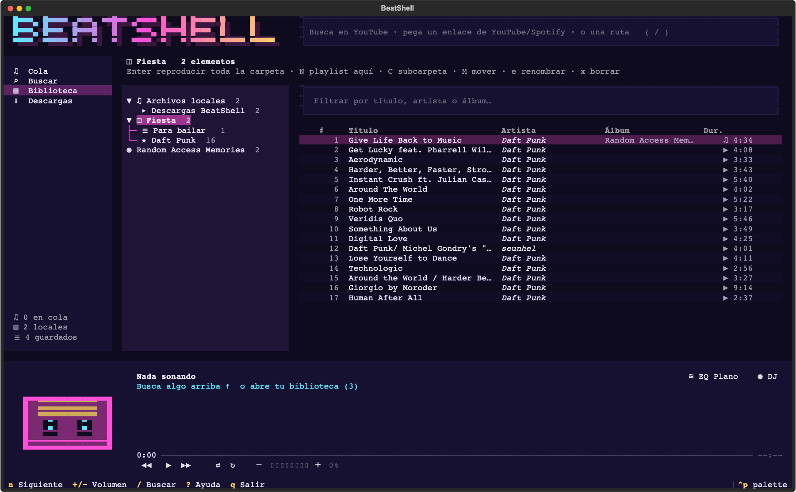

# ▚ BeatShell

Reproductor de música para la terminal, con estética **pixel art**: portadas pixeladas,
logo en fuente de 5×5, visualizador de espectro en tiempo real y temas de color retro.

- **YouTube** como un bot de Discord: escribe lo que quieras oír y suena. También vídeos y playlists por enlace.
- **Spotify**: pega un enlace de canción, álbum o playlist; cada canción se busca en YouTube y se reproduce.
- **Archivos locales**: MP3, FLAC, M4A, OGG, Opus, WAV… organizados en bibliotecas (carpetas).
- **Descargas a MP3** de canciones, playlists de YouTube y playlists/álbumes de Spotify, con título,
  artista, álbum, nº de pista y portada incrustados.
- **Biblioteca organizada**: guarda playlists, álbumes y artistas, y agrúpalos en carpetas (y subcarpetas).
  Al descargar, todo pasa solo a usar el MP3.
- **Exportar e importar** playlists en `.m3u8` (VLC, foobar2000, Music, Winamp…).
- **Ecualizador** de 10 bandas con 13 presets que se escuchan al momento, y **modo DJ** con fundidos entre
  canciones, volumen nivelado y radio infinita.
- **Sin esperas**: YouTube arranca al instante y cambia a alta calidad en marcha, sin cortes.
- Portadas como **imagen real en Kitty y Ghostty** (pixel art nítido); bloques de color en el resto.
- Funciona en **Windows, macOS y Linux**.



## Instalación

Necesitas **Python 3.10+** y, para YouTube, **Deno** (yt-dlp lo usa para leer YouTube).

| Sistema | Requisitos previos |
|---|---|
| macOS | `brew install python deno` |
| Windows | `winget install Python.Python.3.12 DenoLand.Deno` · usa **Windows Terminal** |
| Debian/Ubuntu | `sudo apt install python3-venv libportaudio2` y `curl -fsSL https://deno.land/install.sh \| sh` |
| Fedora / Arch | `portaudio` desde el gestor de paquetes + Deno |

ffmpeg **no hace falta instalarlo**: si no está en el sistema, BeatShell usa uno empaquetado.

Luego, desde esta carpeta:

```bash
./install.sh
```

En Windows (PowerShell):

```powershell
powershell -ExecutionPolicy Bypass -File install.ps1
```

Y a disfrutar:

```bash
beatshell
```

También puedes empezar directamente con algo sonando:

```bash
beatshell "daft punk around the world"
```

## Cómo se usa

Todo empieza en la **barra de arriba** (pulsa `/` para ir a ella):

| Escribes… | Pasa esto |
|---|---|
| `daft punk` | Busca en YouTube y muestra resultados. Enter para escuchar. |
| `+daft punk` | Añade directamente el primer resultado a la cola (modo bot). |
| enlace de vídeo de YouTube | Suena (o se añade a la cola si ya hay algo sonando). |
| enlace de playlist de YouTube | Muestra la playlist: `Enter` reproducir · `A` encolar todo · `G` guardar · `D` descargar. |
| enlace de Spotify (canción/álbum/playlist) | Igual que arriba. Las canciones se buscan en YouTube al reproducirlas. |
| ruta a una carpeta | La añade a la biblioteca. Puedes **arrastrar la carpeta a la terminal**. |
| ruta a un archivo de audio | Lo reproduce. |
| ruta a un `.m3u` / `.m3u8` | Importa la playlist. |

### La biblioteca (`3`)

A la izquierda, un árbol con todo lo tuyo:

```
▾ ♫ Archivos locales          ← tus carpetas de música y las descargas
▾ ◫ Fiesta                    ← carpetas: agrupan lo que quieras, también otras carpetas
    ☰ Para bailar             ← playlist
    ★ Daft Punk               ← artista: sus canciones locales + las más escuchadas en YouTube
  ◉ Random Access Memories    ← álbum
```

- `g` sobre cualquier canción: añadirla a una playlist, **guardar su álbum** o **seguir a su artista**.
- `G` sobre una playlist o álbum de YouTube/Spotify: guardarlo entero en la biblioteca.
- `N` nueva playlist · `C` nueva carpeta · `M` mover a una carpeta · `e` renombrar · `x` quitar.
- `Ctrl+E` exporta la playlist o álbum seleccionado a `.m3u8`; `Ctrl+O` importa uno.
- Enter sobre una carpeta reproduce todo lo que contiene.

### Ecualizador y modo DJ

- `E` abre el ecualizador: muévete por los presets (Rock, Pop, Electrónica, Hip-hop, Reggaetón, Jazz,
  Clásica, Voces, Noche…) y se escuchan al momento. Enter aplica, Esc deshace.
- `j` activa el **modo DJ**: fundido cruzado de 8 s entre canciones, volumen nivelado para que todas
  suenen igual de fuerte y, cuando se acaba la cola, añade solo canciones parecidas (radio infinita).
- También tienes `≋ EQ` y `◉ DJ` como botones clicables en el reproductor.

### Atajos

Pulsa `?` dentro de la app para verlos todos. Los principales:

| Tecla | Acción |
|---|---|
| `espacio` | Reproducir / pausa |
| `n` / `b` | Siguiente / anterior |
| `←` `→` | ±5 s (con Mayús ±30 s) — también puedes hacer clic en la barra de progreso |
| `+` `−` / `m` | Volumen / silencio |
| `s` / `r` | Aleatorio / repetir (no → todo → una) |
| `1`…`4` | Cola · Buscar · Biblioteca · Descargas |
| `Enter` | Reproducir la canción seleccionada |
| `a` / `A` | Añadir a la cola / añadir todo |
| `i` | Reproducir a continuación |
| `g` / `G` | Guardar (playlist, álbum o artista) / guardar la lista entera |
| `d` / `D` | Descargar MP3 / descargar todo |
| `x` | Quitar de la cola o playlist (en el árbol de la biblioteca: quitar ese elemento) |
| `Mayús ↑↓` | Mover canciones en la cola o playlist |
| `f` · `R` | Biblioteca: añadir carpeta de música · re-escanear |
| `N` · `C` · `M` · `e` | Biblioteca: nueva playlist · nueva carpeta · mover · renombrar |
| `Ctrl+E` · `Ctrl+O` | Exportar / importar playlist `.m3u8` |
| `E` · `j` | Ecualizador · modo DJ |
| `Ctrl+B` | Mostrar / ocultar el menú lateral (se recuerda al volver a abrir) |
| `t` | Cambiar tema: *beatshell*, *gameboy*, *sunset*, *ice* |
| `q` | Salir (la cola se guarda y se recupera al volver) |

Los botones del reproductor (◀◀ ▶ ▶▶, aleatorio, repetir, volumen) también funcionan con el ratón.

## Dónde se guardan las cosas

- **Música descargada**: `~/Music/BeatShell/<nombre de playlist o álbum>/Artista - Título.mp3`
  (las sueltas van a `Canciones/`). Esta carpeta se añade sola como biblioteca.
- **Configuración, playlists y cola**: en la carpeta de datos del sistema
  (macOS `~/Library/Application Support/BeatShell`, Linux `~/.local/share/BeatShell`,
  Windows `%LOCALAPPDATA%\BeatShell`). Puedes cambiarla con la variable `BEATSHELL_HOME`.

### `config.json`

| Clave | Para qué |
|---|---|
| `download_dir` | Carpeta de descargas |
| `mp3_quality` | `"0"` = VBR V0 (~245 kbps, por defecto) · `"320"` = CBR 320 kbps |
| `concurrent_downloads` | Descargas simultáneas (2 por defecto) |
| `pixel_covers` | `false` para portadas sin reducir la paleta |
| `sidebar` | `"auto"` (se oculta en ventanas estrechas), `"show"` o `"hide"`. Cambia con `Ctrl+B` |
| `eq_preset` | Preset del ecualizador (se cambia con `E`) |
| `dj_mode` / `dj_crossfade` | Modo DJ y segundos de fundido entre canciones (8 por defecto) |
| `cover_renderer` | `"auto"` (imagen real en Kitty/Ghostty), `"kitty"` (forzar) o `"bloques"` (nunca) |
| `spotify_client_id` / `spotify_client_secret` | Opcional, ver abajo |

### Playlists de Spotify de más de 100 canciones

Sin configurar nada, Spotify solo deja leer las primeras 100 canciones de una playlist. Para importar
playlists completas, crea una app gratuita en <https://developer.spotify.com/dashboard>, copia su
*Client ID* y *Client Secret* en `config.json` y listo.

## Cosas a saber

- **Por qué YouTube suena al instante**: YouTube obliga a esperar lo que duraría su anuncio antes de
  servir el audio de alta calidad. BeatShell arranca con un stream que no tiene esa espera y, en cuanto
  la alta calidad está lista, cambia en mitad de la canción sin que se note. Además precarga la siguiente
  de la cola y la canción sobre la que te detienes en cualquier lista.
- Las canciones que ya descargaste suenan siempre desde el disco, las abras desde donde las abras.
- Si YouTube deja de funcionar, casi siempre se arregla actualizando yt-dlp:
  `.venv/bin/pip install -U "yt-dlp[default]"` (en Windows `.venv\Scripts\pip ...`).
- Los colores se ven mejor en terminales con *true color*: Windows Terminal, iTerm2, WezTerm, Kitty,
  Alacritty, GNOME Terminal… (Terminal.app de macOS funciona, con menos colores).
- En **Kitty** y **Ghostty** las portadas se dibujan como imagen real con su protocolo gráfico.
- Descarga solo música que tengas derecho a guardar; respeta los términos de cada servicio.

## Cómo está hecho

| Pieza | Tecnología |
|---|---|
| Interfaz | [Textual](https://textual.textualize.io) |
| Audio | ffmpeg decodifica a PCM → [sounddevice](https://python-sounddevice.readthedocs.io) (PortAudio) lo reproduce |
| Visualizador | FFT con NumPy de lo que está sonando, en bandas logarítmicas |
| Ecualizador / DJ | Filtros de ffmpeg (`equalizer`, `dynaudnorm`) aplicados al vuelo |
| Portadas en Kitty | [textual-image](https://github.com/lnqs/textual-image) (protocolo gráfico de Kitty) |
| YouTube | [yt-dlp](https://github.com/yt-dlp/yt-dlp) |
| Spotify | Página pública de *embed* (sin cuenta) o Web API con credenciales |
| Etiquetas y portadas | mutagen + Pillow |

```
src/BeatShell/
├── audio.py        motor de audio: dos voces (fundidos, cambio a HQ), espectro
├── eq.py           presets del ecualizador y nivelado del modo DJ
├── art.py          pixel art: medios bloques, logo, portadas, sprites generativos
├── library.py      archivos locales, colección (playlists/álbumes/artistas/carpetas), M3U8
├── playqueue.py    cola con aleatorio y repetición
├── services.py     resolver pistas → audio, descargas a MP3
├── sources/        youtube.py, spotify.py, detección de enlaces
└── ui/             app, biblioteca, widgets, ventanas y estilos (.tcss)
```

## Autores

- Ismael Dios Miguez ([@IdaxDiosMiguez](https://github.com/IdaxDiosMiguez))
- Aldan Lema Touza ([@aldanlt](https://github.com/aldanlt))

## Licencia

[GNU General Public License v2.0](LICENSE)
